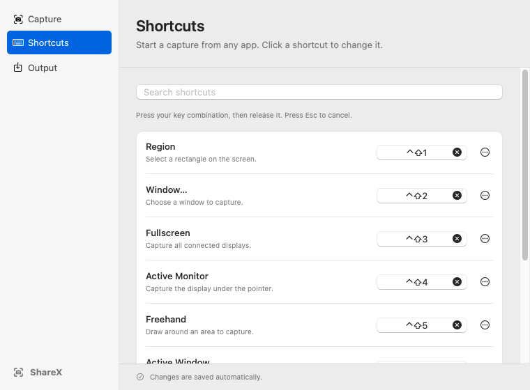

# Capture and edit a screenshot

ShareX runs in the macOS menu bar. Use the camera icon to start a capture or open **Settings…**. Get the [latest built package](../README.md#latest-built-package), then follow the [installation instructions](../INSTALL.txt) for the ad-hoc signed, non-notarized build.

## Make your first capture

1. Open ShareX from Applications.
2. Allow Screen Recording in **System Settings > Privacy & Security** when macOS requests it.
3. Quit and reopen ShareX after you change that permission.
4. Press **Control+Shift+1** and drag a rectangle around the area you want.
5. Choose annotation tools from **Tool**. Click **Done** to finish.
6. Paste the image into another app with **Command+V**.

A new installation also saves a PNG in `~/Pictures/ShareX`. An update preserves your existing save preference and folder.

Press **Esc** to cancel a capture without exporting it. While you type a text annotation, **Esc** or **Return** first commits the text. Press the key again to cancel or finish the capture.

## Choose a capture

Choose a command from the ShareX menu, or use its assigned shortcut.

| Command | What to capture | Default shortcut |
| --- | --- | --- |
| Region | Drag a rectangle across one or more displays. | Control+Shift+1 |
| Window… | Click a window. | Unassigned |
| Fullscreen | Capture all connected displays in one image. | Unassigned |
| Active Monitor | Capture the display under the pointer. | Unassigned |
| Freehand | Draw around an area. The area outside the path is transparent. | Unassigned |
| Active Window | Capture the frontmost window. | Unassigned |
| Monitor… | Click a display. | Unassigned |
| Last Region | Capture the previous area again. | Unassigned |

The fixed top toolbar appears on every display. Before selection, its **Tool** menu offers Region, Freehand, Window, Monitor, and Full Desktop. Fullscreen editing stays on the original displays. A drag can cross a display boundary and remains one undo action.

If a participating display moves, changes size, or disconnects, **Last Region** starts a new region selection. Common desktop translation, scale changes, and extra untouched displays preserve the saved area. Desktop gaps are transparent in the image.

In **Settings… > Capture**, set a delay to capture a menu or another temporary view. You can also include the pointer, add a border or shadow, and enable **Open the editor for fixed-area captures**.

## Select an exact area

Enable **Settings… > Capture > Show magnifier and crosshair**. Use the magnifier while you select a region or freehand area. The size label shows the crop dimensions in image pixels, before any border or shadow.

After selection, choose **Tool > Crop**. Drag a crop handle to resize the area, or drag elsewhere to replace it. Use these keys for small adjustments:

| Keys | Adjustment |
| --- | --- |
| Arrow key | Move the crop by one image pixel. |
| Shift+Arrow | Move the crop by ten image pixels. |
| Option+Left or Option+Right | Move the right edge by one image pixel. |
| Option+Up or Option+Down | Move the bottom edge by one image pixel. |
| Option+Shift+Arrow | Adjust the same edge by ten image pixels. |

The magnifier also works in **Crop**. It hides near protected areas to avoid showing the original pixels beneath a redaction.

## Add or change annotations

Choose a tool from **Tool**. The keys below are optional. Drag to draw shapes and strokes. Click to place text or a step marker.

| Tool | Key | Use |
| --- | --- | --- |
| Select | V | Select and move an annotation. Drag its handles to resize it. |
| Rectangle | R | Draw a box. Enable **Fill** for a solid box. |
| Ellipse | E | Draw an oval. |
| Line | L | Draw a line. |
| Arrow | A | Point to an item. |
| Highlighter | H | Tint an area. |
| Blur | B | Blur an area. |
| Pixelate | P | Replace detail with blocks. |
| Spotlight | S | Dim the area outside a shape. |
| Freehand | F | Draw a pen stroke. |
| Text | T | Add text. To edit existing text, select this tool and click the text. |
| Step marker | I | Add a numbered marker. |

Open **Style** to change color, width or text size, opacity, fill, and effect strength. Hold **Shift** while you draw a shape to constrain it.

To move an annotation, press **V** and select it. Arrow keys move it by one point. **Shift+Arrow** moves it by ten points.

Choose **More > Delete selected** to remove the selected annotation. A right-click also deletes the annotation under the pointer. With no annotations, a right-click returns to area selection or cancels a fixed-area capture.

Choose **More > Undo** or **More > Redo**. Click **Done** to finish or **Cancel** to close the capture. Optional keys remain Command+Z, Shift+Command+Z, Return, and Command+C.

## Hide sensitive content

Blur and pixelation obscure detail but do not guarantee that the content cannot be inferred. To cover sensitive content completely:

1. Choose **Tool > Rectangle**.
2. Open **Style** and select a color, such as black.
3. Enable **Fill**.
4. Move **Opacity** fully right to make the box opaque.
5. Draw the box over the entire sensitive area.
6. Check the finished image before you share it.

Other screen-recording or screen-sharing apps may capture the editor before you finish the redactions. Stop those apps before you open sensitive content.

## Set shortcuts

Open **Settings… > Shortcuts**. Changes save automatically.

1. Use **Search shortcuts** to find a command.
2. Click its shortcut control.
3. Press your key combination, then release it. Press **Esc** to cancel.

If another ShareX command uses the combination, the app rejects it and names the conflict. Clear or change the other assignment, or choose another combination.

Use the row's options menu to select **Clear Shortcut** or **Restore Default**. A per-command restore also checks for a conflict. Use **Restore All Defaults…** and confirm **Restore Defaults** to replace all eight assignments. Region receives Control+Shift+1. The other seven commands become unassigned. Existing valid bindings, including earlier factory defaults, remain assigned until you change or restore them.

If a stored shortcut is damaged, the app recovers it at launch. Valid custom and disabled assignments stay unchanged. A recovered default that conflicts with a valid assignment stays unassigned.

## Save and recover an image

Open **Settings… > Output**. Leave **Save each capture to a folder** enabled to save a PNG as well as the clipboard image. Use **Choose Folder…** to select the destination. **Use Default Folder** restores `~/Pictures/ShareX`. Check the folder status below these controls.

Turn off **Save each capture to a folder** for clipboard-only output. The clipboard image supports both PNG and TIFF.

If an output fails, read the alert to see which destination succeeded. **Retry** repeats only the failed output. **Save As…** lets you save the PNG elsewhere. Check the folder permissions and available disk space if the file cannot be saved.

Keep the recovery dialog open until you have an output you need. **Done** dismisses the dialog when at least one output succeeded. **Discard** dismisses it when neither succeeded. The success sound plays only after every requested output succeeds.

See [the review index](../reviews/README.md) for validation evidence and limits. Physical hotkeys, interactive permission prompts, and real Retina or mixed-display setups still need checks on a Mac.

## Reduce a large capture

If Done is disabled with a size message, choose **Tool > Crop** and reduce the selected area. The limit is 64 Mi pixels. The image uses the highest scale of the displays that the crop touches. The app does not reduce image detail to fit the limit.

If the display layout changes while you edit, the session cancels. Start a new capture after the displays settle.
